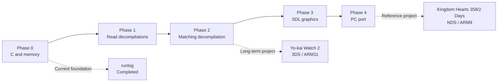

# My road to decompilation in 358/2 days

Hi. I'm Carlos Chacón, a Spanish full-stack developer, or at least that's how I see myself.

For some months, I have been very interested in game decompilation and reverse engineering. In September 2026, one of my favorite games was fully decompiled: [Kingdom Hearts 358/2 Days](https://github.com/Yokimitsuro/khdays-decomp). That made me feel it was the right moment to enter the world of decompilation. I have set myself the challenge of learning how to decompile a game in 358 and a half days.

As a programming teacher, I also think I should learn how to learn so I can help my students learn. Okay, that sounds weird.

This project is divided into five phases.

## Phase 0 - Learning C and how to decompile
>
> 📖 **Syllabus:** [docs/temario/00-fundamentos-c-y-memoria.md](./docs/temario/00-fundamentos-c-y-memoria.md) · 💻 **Code:** [fase-0-fundamentos-c/](./fase-0-fundamentos-c/)

First of all, to decompile software, I need to learn how to program in C and probably C++.

Decompilation projects often use C because the goal is to recreate the original game's behavior and, in matching projects, its compiled output as closely as possible. This requires a good understanding of low-level programming: memory layout, pointers, and structures.

I'm following [Beej's Guide to C Programming](https://beej.us/guide/bgc/) and [this book from a Spanish website](https://librosgratis.dev/leer/c-introduccion-programacion/).

Alongside local C programming drills (like the [runlog project](./fase-0-fundamentos-c/proyectos/p3-runlog/)), I practice daily in [Decomp Academy](https://decomp-academy.dev/), an interactive platform recommended directly by Yokimitsuro (creator of `khdays-decomp`) to practice matching decompilation with historical compilers (`agbcc` for GBA and Metrowerks CodeWarrior for GameCube). Following the GBA ARM/Thumb course is helping me connect low-level concepts directly with Nintendo DS hardware.

This will be difficult, but I'm ready for it.

## Phase 1 - Reading Decompilations
>
> 📖 **Syllabus:** [docs/temario/01-lectura-decompilaciones.md](./docs/temario/01-lectura-decompilaciones.md) · 💻 **Code:** [fase-1-lectura-decomp/](./fase-1-lectura-decomp/)

Before creating a decompilation, I need to be able to read code from an existing project. I want to learn how to understand and document these projects, so I will study the decompilations of [Kingdom Hearts: Chain of Memories](https://github.com/Pheenoh/khcom) and [Kingdom Hearts 358/2 Days](https://github.com/Yokimitsuro/khdays-decomp).

Recently, I tried to study the code of a decompilation and it was all Greek to me. Learning to read it will be a long process.

## Phase 2 - Starting a Matching Decompilation
>
> 📖 **Syllabus:** [docs/temario/02-matching-decompilation.md](./docs/temario/02-matching-decompilation.md) · 💻 **Code:** [fase-2-matching-decomp/](./fase-2-matching-decomp/)

In this phase, I will learn the workflow of a matching decompilation project. I will begin with small and well-documented functions, learning how to compare the original assembly with the code I write and how to reproduce the same compiled output.

A matching decompilation is not only about recreating code that behaves like the original. The goal is to produce compiled output that matches the original binary as closely as possible, sometimes byte by byte.

As a long-term goal, I would like to work on [Yo-kai Watch 2: Psychic Specters](./fase-2-matching-decomp/yokai-watch-2-decompiled/) (Nintendo 3DS / ARM11), but I will approach it gradually. First, I need to understand the toolchain, the target architecture, the compiler behavior, and the structure of a real decompilation project.

If Yo-kai Watch 2 proves to be too ambitious at this stage, I will use Mario & Luigi: Superstar Saga or another smaller Game Boy Advance project as an intermediate challenge.

## Phase 3 - Learning SDL
>
> 📖 **Syllabus:** [docs/temario/03-graficos-multimedia-sdl.md](./docs/temario/03-graficos-multimedia-sdl.md) · 💻 **Code:** [fase-3-graficos-sdl/](./fase-3-graficos-sdl/)

Once I have learned how to decompile a project, I want to learn how to create a port. For this, I need to learn how to use SDL with C. I have no experience creating games from scratch, but it could be interesting.

## Phase 4 - Learning How to Port a Game
>
> 📖 **Syllabus:** [docs/temario/04-ports-nativos-a-pc.md](./docs/temario/04-ports-nativos-a-pc.md) · 💻 **Code:** [fase-4-pc-port/](./fase-4-pc-port/)

Finally, once I have learned how to decompile, read the code of a decompilation and work with graphics, I want to port a game or make a game demo. My goal is to learn how to port a game to PC. If I can make a change to an existing project, that will be fine too.

## Farewell

I don't know if one year is enough time to learn all these things, but a year is a lot of time. In only 15 days, I have already learned a lot, and I want to learn more.

Sometimes I feel very tired, so I need to take a break while learning. I don't want to give up, because learning reverse engineering will be very useful for my career.

For this reason, and many more, all my progress on this project will be public in this repository. The development diary is currently in Spanish, and it will be available in English soon.

## Project documentation

### General Documentation

- [Project context](./docs/contexto-proyecto.md): Goals, hardware specifications, and overall challenge vision.
- [AI usage policy (English)](./docs/AI-use-policy.MD) · [(Spanish original)](./docs/politica-uso-IA.MD): Transparent statement on the learning role of AI.
- [Learning roadmap](./docs/ROADMAP.md): Atomic checklist and daily task tracking.
- [Development diary](./docs/diario/): Daily devlog entries with Mermaid architecture diagrams.
- [Learning methodology](./docs/methodology.md): Atomic habits and 4-step learning cycle.
- [Resources & references](./docs/recursos.md): Recommended books, links, and reference tools.

### Phase Syllabi & Workspaces

- **Phase 0 · C & Memory Fundamentals**: [Syllabus](./docs/temario/00-fundamentos-c-y-memoria.md) · [Workspace](./fase-0-fundamentos-c/) · [Runlog Project](./fase-0-fundamentos-c/proyectos/p3-runlog/)
- **Phase 1 · Reading Decompilations**: [Syllabus](./docs/temario/01-lectura-decompilaciones.md) · [Workspace](./fase-1-lectura-decomp/)
- **Phase 2 · Matching Decompilation**: [Syllabus](./docs/temario/02-matching-decompilation.md) · [Workspace](./fase-2-matching-decomp/) · [Yo-kai Watch 2 Submodule](./fase-2-matching-decomp/yokai-watch-2-decompiled/)
- **Phase 3 · Graphics & Multimedia (SDL)**: [Syllabus](./docs/temario/03-graficos-multimedia-sdl.md) · [Workspace](./fase-3-graficos-sdl/)
- **Phase 4 · Native PC Source Ports**: [Syllabus](./docs/temario/04-ports-nativos-a-pc.md) · [Workspace](./fase-4-pc-port/)

## Legal notice

All ROMs and game files used in this project must be legally owned by the user. This repository does not distribute copyrighted game data.
