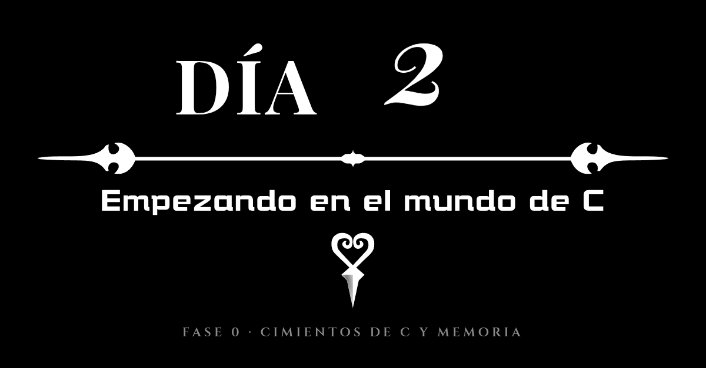

# Diario de aprendiendo a decompilar en 358/2 dias - Dia 2: (Empezando en el mundo de C)

### Info:
- **Fecha**: 28 de Septiembre de 2026
- **Objetivo general de la sesión**: Primeros pasos en C: variables primitivas, tamaño en RAM y control de flujo.
- **Fase**: Fase 0 · Cimientos de C y Memoria de Bajo Nivel

Empieza mi viaje en el mundo de la decompilación, desde mi desconocimiento tengo más o menos un *roadmap* de lo que tengo que hacer, antes de mirar ensamblador, estudiar arquitectura de una consola necesito aprender C y de paso programación a bajo nivel, aunque se programar la programación a bajo nivel es otro mundo, es dar instrucciones muy claras, ya que estas trabajando directamente sobre la memoria RAM del equipo, cuando cree un int tengo que saber, vale, esto ocupa 4 bytes en la memoria RAM y tengo que leerlo como int, leer un int como un float podría devolver 2123141 en lugar de 6.

## Afrontando C

Se que C no se diferencia en las bases de cualquier otro lenguaje de programación, los *if*, los *for* y los *while* siguen ahí, pero son las particularidades de C las que me van a hacer que este camino sea mucho mas complicado, los punteros, las estructuras y el hecho de ser una programación estructurada, es decir, todo se ejecuta "como un unico fichero" y al no poder depender de la programación orientada a objetos debo cambiar mi manera de pensar, comprender que son los .c, los .h y los makefile, la he toqueteado hace tiempo, pero no demasiado en profundidad, ahora me tocará profundizar un poco, mejor dicho, profundizar mucho.

Este primer día trabajando con C, he aprendido lo básico, lo tipico de cualquier lenguaje, asignación y lectura de variables y control de flujo con condicionales y bucles, para aprender C estoy siguiendo [la guía de Beej para C en su versión traducida al español](https://stefanogassmann.github.io/BGCSpanish/), podría seguirla en inglés pero teniendo esta alternativa, voy a leerla en español porque me consume menos esfuerzo, pero aún asi si necesito mirar algo mas en profundidad, leer [la versión inglesa](https://beej.us/guide/bgc/).

Pero tambien he pensado en mirar los libros de [C en el repositorio de Midu de libros gratuitos](https://librosgratis.dev/#c) además en este mismo sitio [hay libros de SDL](https://librosgratis.dev/leer/programacion-videojuegos-sdl/) que me vendrá muy bien.

Todas las entradas del diario tendrán una checklist de mis objetivos de este día o jornada, veo esto como un viaje y quiero ser totalmente transparente con el proceso.

Por último, como programador quiero agradecer por vivir en una época en la que el conocimiento sobre la informatica esta al alcance de todo el mundo, tienes toda la documentación necesaria, otra cosa es lo que quieras hacer con eso, puedes buscar conseguir crecer como programador y como persona, crear cosas que hagan que la vida de la gente sea mas fácil, o puedes vibecodear un port de Sonic Adventure a PC totalmente ilegible *No debí escribir esto porque no estaba en la entrada original, pero no pude evitarlo*.

### Checklist:

#### Guia de Beej para la programación en C

- [x] Capitulo 1. Introducción.
- [x] Capitulo 2. Hello World.
- [x] Capitulo 3. Variables y Control de flujo.

*Esto es aproximadamente el 10% del libro.*

### Tags:
#DecompilandoEn358Dias #C #MemoriaRAM #BeejGuide #BajoNivel

