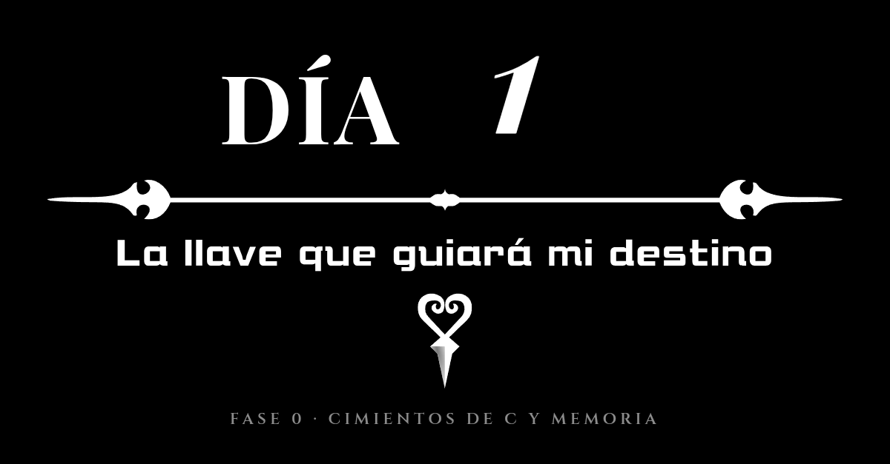

# Diario de aprendizaje · Día 1 (La llave que guiará mi destino)

***Esta entrada del diario está siendo escrita de forma "retroactiva" puesto que el diario de este proyecto empezó a partir del día 2, por lo que esta entrada es una representación de cómo me sentía en ese momento, espero que les guste.***

Soy Carlos Chacón, a.k.a. ChaconMoon; soy un desarrollador multiplataforma experto en Python (según yo), aunque de momento estoy en búsqueda de empleo y parece que últimamente no me está yendo tan mal, pero eso no es importante.

Desde hace años me ha interesado el mundo de la ingeniería inversa de videojuegos, sobre todo tras ver que se logró portear Zelda: Majora's Mask, algo que hace años era un nicho. El mítico [ZeldaRET](https://zelda.deco.mp/) siempre estará en mi corazón; gracias a ellos miraba constantemente cómo decompilaban Zelda: Majora's Mask y cada avance me alegraba mucho. Todo esto nos llevó al mítico [Ship of Harkinian](https://www.shipofharkinian.com/) y [2 Ship 2 Harkinian](https://github.com/2ship2harkinian/2ship2harkinian); ambos proyectos, junto con el [port de Mario 64](https://github.com/sm64-port/sm64-port), se convirtieron en la prueba de que se puede hacer ingeniería inversa a un proyecto entero y convertirlo en ports a PC, y me sorprende que Nintendo no haya tomado medidas, por muy legales que sean estos proyectos.

En esa época no estábamos muy acostumbrados a esta clase de proyectos; quiero recordar que el port de Mario 64 te lo tenías que compilar tú mismo, cosa que estoy seguro que a más de uno se le hizo rarísima, pero con el tiempo nos hemos acostumbrado.

Por ello, ahora que soy mucho más viejo y más sabio que en ese momento, creo que es hora de incursionar en esta área. Además, siento que lo he hecho en el momento ideal: está claro que 2026 y 2027 van a ser los años de las decompilaciones y ports; es decir, estamos ya decompilando software de Switch y cualquier día nos levantamos con Super Mario Bros. Wonder en PC o Breath of the Wild, algo que recuerdo que hace años se veía imposible, pero que hoy en día es una realidad.

Obviamente todo esto es gracias a la IA. Entiendo que es normal que equipos como ZeldaRET o hedge-dev se sientan mal por esto: un trabajo que antes tomaba años ahora se hace en semanas, pero recordemos que gran parte del trabajo actual se ha conseguido gracias a los descubrimientos de los que "me precedieron", y por ello les estaré agradecido. En especial al creador del port que ha sido el detonante de esto: la decompilación y el port de Kingdom Hearts 358/2 Days y el de Kingdom Hearts Chain of Memories. Una decompilación que se ha hecho mientras lo jugaba, y 358/2 Days, que es uno de mis juegos favoritos de la DS, ha sido el desencadenante: quiero ser capaz de entender y trastear con una decompilación para comprenderla y trabajar con ella.

Por eso este proyecto - objetivo personal está dedicado a:

- [ZeldaRET (Por decompilar Ocarina of Time, Majora's Mask y Twilight Princess)](https://zelda.deco.mp/)
- [N64Decomp (Por ser los primeros en decompilar un juego de la Nintendo 64)](https://github.com/n64decomp)
- [Yokimitsuro (Por sus avances en la ingeniería inversa de Kingdom Hearts)](https://github.com/Yokimitsuro)
- [Pheenoh (Por sus avances en la ingeniería de Twilight Princess y decompilar Chain of Memories)](https://github.com/Pheenoh/)
- [pret (Por sus avances en la ingeniería inversa de Pokémon y sus aportes a la comunidad de GBA y DS)](https://github.com/pret)

Gracias a todos ellos y a muchos más sé que no camino solo; los descubrimientos que han hecho todos ellos guían mi camino.

La newsletter es mi primer paso, pero posteriormente quiero trasladar esto a directos en YouTube o Twitch; esto para mí es un viaje en el que espero no caminar solo.

Me he propuesto la meta simbólica de conseguir acostumbrarme al mundo de la decompilación en 358/2 días. Este reto empieza el 27 de septiembre; si no me salen mal las cuentas, termina el 21 de septiembre de 2027.

Mi viaje empieza ahora, mi corazón será mi guía y mis amigos serán mi mejor arma. Espero salir más fuerte de lo que empecé; sé que será duro, querré abandonar, tal vez el desarrollo de la IA pueda conmigo, pero saldré mejor como programador y como persona. Vale, tal vez eso sea demasiado... pero sé que al igual que un proyecto anterior mío, una API de South Park, saldré mejor de lo que estoy ahora.

Nos veremos próximamente.

