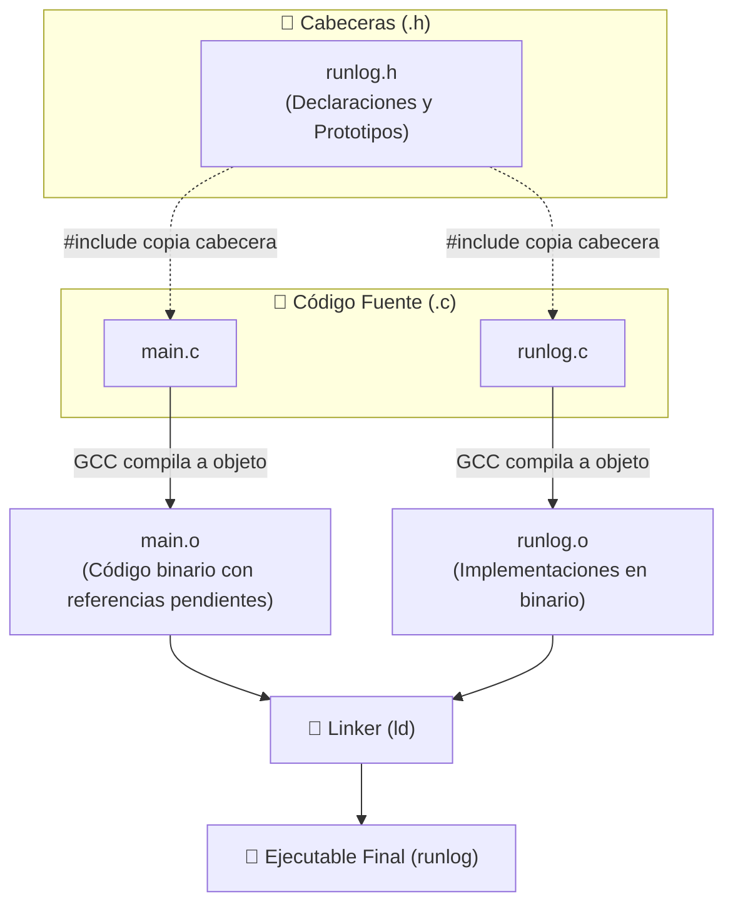

# Diario de aprendiendo a decompilar en 358/2 dias - Dia 11: (Testing y arquitectura modular)

### Info:
- **Fecha**: 7 de Octubre de 2026
- **Objetivo general de la sesión**: Cierre del Bloque 0.1: modularización (.h vs .c), include guards y testing con sanitizers.
- **Fase**: Fase 0 · Cimientos de C y Memoria de Bajo Nivel

---

## Modularización en C: organizando el código sin clases

Si hay algo característico de C es que no permite la programación orientada a objetos, es decir, es todo programación estructurada: el código se organiza en funciones e instrucciones secuenciales sin clases. Mantener un software de 30k o 40k líneas en un solo archivo sería imposible; para ello se recurre a la modularidad con los ficheros `.c` y `.h`.

Si lo he entendido bien, así funcionan:

En `main.c` llamo a `runlog.h` y al momento de compilar se copia totalmente en el main, pero lo único que hace el compilador es saber que hay funciones con esos nombres, aunque no sabe su implementación; con eso tenemos su binario `main.o`.

Cuando se compila `runlog.c`, recibe las mismas indicaciones de las cabeceras, implementa esas funciones y se crea `runlog.o`, es decir, el binario compilado.

Luego entra en juego el *linker*: este programa coge ambos archivos de objeto y dice: *"Vale, esta función `calculate_ranking()` de `runlog.o` es la que necesita `main.o`"*, rellenando los huecos que se dejó la compilación de `main.o`.

Esto es lo que he aprendido después de interminables quebraderos de cabeza, pero espero que este esfuerzo merezca la pena.

## Testing en C

Siguiendo todo este proceso he creado los tests para algunas de las funciones. En C hay múltiples formas de hacer testing, pero he preferido hacerlo mediante `assert` al ser la forma a la que estoy más acostumbrado y con la que me he sentido relativamente cómodo, aún sin comprender al 100% todo sobre la modularidad en C, pero espero ir dominándolo con el tiempo.

## Despedida

Sí, ya lo sé: mucho texto, otra vez. Pero quería asegurarme de entender bien esta parte; en los próximos días quiero empezar a estructurar esta newsletter para publicarla.

Próximamente publicaré las entradas de los días 12 y 13 en las que contaré cómo ha sido el proceso de desarrollar la newsletter, pero quiero probarla antes de escribir sobre ella.

Con esto termina la introducción a la newsletter, tendréis noticias mías próximamente, ojalá pronto.

¡Tened un buen día, jeje!

### Checklist:
- [x] Dividir el proyecto runlog en submódulos para facilitar su comprensión.
- [x] Empezar a testear el módulo de runlog.

### Tags:
#DecompilandoEn358Dias #C #UnitTesting #AddressSanitizer #Modularidad #CleanCode

---
