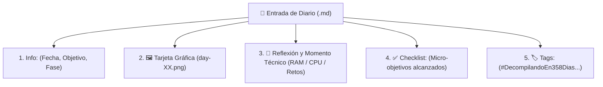
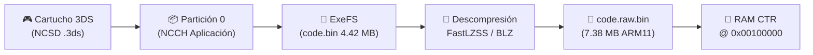

# Diario de aprendiendo a decompilar en 358/2 dias - Dia 12: (Newsletter (parte 1))

### Info:
- **Fecha**: 8 de Octubre de 2026
- **Objetivo general de la sesión**: Empezar a planificar la fase 2 del proyecto y seguir desarrollando la newsletter
- **Fase**: Fase 0 · Cimientos de C y Memoria de Bajo Nivel

---

## Empezando a escribir la newsletter

En este día ya he decidido qué estructura va a seguir la newsletter, la misma que tiene esta entrada:

Info: Resumen de la sesión, con fecha y demás, una especie de resumen rápido.

(Imagen de cabecera)

(Anécdota y resumen de la sesión)

(Checklist)

(Tags)

Esta estructura es obligatoria y tengo a Antigravity revisando que todas las entradas tengan esta estructura.

Mi idea es escribir un sistema universal que pueda llevar a cualquier sitio que admita meterle un fichero Markdown —que no son precisamente pocos—. Originalmente tenía pensado Substack, pero no me termina de convencer, así que probaré otras.

Mi idea es publicar de forma retroactiva todas y luego seguir por ahí, aunque me preocupa el formato: estas entradas de texto son muy densas y quiero hacerlas lo más legibles posible, así que no me extrañaría reestructurar entradas de forma retroactiva.

## Planificando la fase 2

Adicionalmente estoy empezando a planear mi banco de pruebas para la fase 2 del proyecto, en el que haré una prueba de decompilar parte de un software, aunque de eso hablaré más en profundidad más adelante.

Aunque bueno, lo podéis ver en el repo, creo que es un reto que me queda grande, pero no es mi intención decompilar el juego entero, sino que había pensado en algún Mario y Luigi.

Espero que el reto no me quede grande, lo veremos en su momento.

Nos vemos jeje.

### Checklist:

- [x] Empezar la implementación del sistema universal de notas en Markdown
- [x] Extracción de datos del juego de 3DS para su posterior análisis (De momento solo en el equipo local, posteriormente se hará un reto aparte)

### Tags:

#DecompilandoEn358Dias #Nintendo3DS #ARM11 #FastLZSS #YokaiWatch2 #ReverseEngineering #Newsletter
