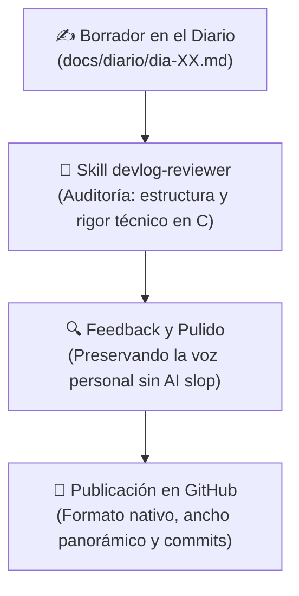

# Diario de aprendiendo a decompilar en 358/2 dias - Dia 13: (Newsletter (parte 2))

### Info:
- **Fecha**: 9 de Octubre de 2026
- **Objetivo general de la sesión**: Estandarización del blog de desarrollo, creación de la skill devlog-reviewer y preparación del lanzamiento.
- **Fase**: Fase 0 · Cimientos de C y Memoria de Bajo Nivel

## Revisando y probando la newsletter

Llegó el día de publicar la newsletter y a lo largo de la jornada he probado múltiples opciones. Al final Substack no me vale, no tiene una API con la que pueda interactuar, así que mientras revisaba las entradas de los días 10 y 11 le he pedido a Antigravity un prototipo para publicar en Buttondown, con resultados buenos aunque he tenido que iterar mucho. He conseguido lo que quería, pero lo único que no me convence es que, al ser un ancho tan corto, da la impresión de que es mucho más texto del que es realmente y no me termina de gustar. Al día siguiente barajaré otras alternativas.

Esto ha sido todo; hoy no hay novedades de programación puesto que he estado únicamente con el diario de desarrollo.

### Checklist:

- [x] Probar el sistema de publicación automática en Buttondown
- [x] Reordenar y pulir los artículos de los Días 10 y 11 listos para publicar.

### Tags:
#DecompilandoEn358Dias #Newsletter #DevlogReviewer
