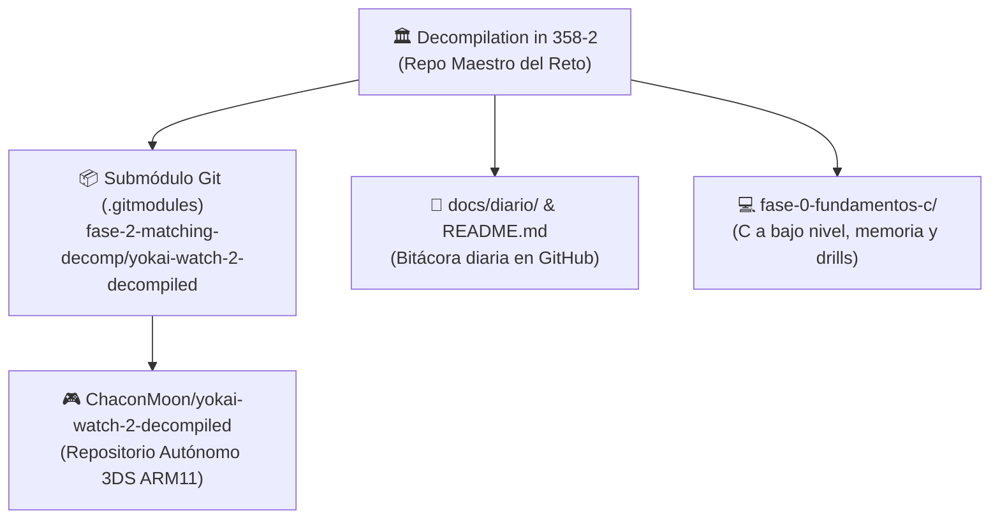

# Diario de aprendiendo a decompilar en 358/2 dias - Dia 14: (Submódulos Git, READMEs y GitHub como medio oficial)

### Info:
- **Fecha**: 10 de Octubre de 2026
- **Objetivo general de la sesión**: Desacoplamiento de Yo-kai Watch 2 como repositorio independiente con submódulo Git, añadir diagramas Mermaid en el diario y consolidación de GitHub como plataforma oficial.
- **Fase**: Fase 0 · Cimientos de C y Memoria de Bajo Nivel

---

## Incorporando diagramas y estableciendo el diario definitivo

AL FIIIIN.

Tras probar múltiples medios para publicar la newsletter (Buttondown, Dev.to y Quartz), he optado por la solución más simple y la que me va a suponer menos esfuerzo: que la bitácora se lea directamente desde GitHub. Me ahorro APIs y meterle más servicios a este proyecto, que ya bastante complejidad tiene por sí mismo.

Creo que mi error con las anteriores propuestas fue enfocarlo demasiado a un formato newsletter y no centrarme en lo que quiero: un diario de desarrollo, algo personal en lo que contar mis experiencias.

Además, ahora el diario incorpora diagramas con las cosas que explico para hacerlo de forma más visual; estos están hechos con Mermaid gracias a Antigravity, pero intentaré sacar tiempo para trastear con ellos yo mismo. Un esquema bien puesto ahorra quinientas palabras de texto denso.

---

## Planificando la fase 2 con Yo-kai Watch 2

Ahora mismo estoy en la fase 0 del proyecto/reto, donde simplemente estoy aprendiendo C. En la fase 1 intentaré empezar a leer alguna decompilación y en la fase 2 intentaré decompilar algún proyecto, ya sea completo o seguramente parcial. Para decompilar he optado por hacerlo con Yo-kai Watch 2, la versión Mentespectros. Y dirás: ¿por qué el 2 y no el 1 o Busters?

Simple: el 2 (y en concreto la versión Mentespectros) es el juego más querido de la saga, y estoy seguro de que en base a este se podrían derivar las versiones de Carnánimas y Fantasqueletos, e incluso de forma parcial las de Yo-kai Watch 1 y 3. Podría ser un gran paso para la comunidad de Yo-kai Watch y quiero dedicarle mi tiempo y mi esfuerzo a una comunidad que me ha dado tanto.

OJO: esto no es un «voy a empezar ya», sino un «tengo la intención de hacerlo cuando tenga experiencia» (y si alguien se me adelanta, ¡bienvenido sea, sumaremos fuerzas!).

El proyecto de decompilación de Yo-kai Watch 2 está enlazado dentro de este repositorio y a su vez es un repositorio independiente que iré poniendo a punto. Ahora mismo es un banco de pruebas inicial: ya he extraído el archivo de código (`.code`) del juego; más adelante tocará aprender a analizarlo.

Espero que Level 5 no tire el proyecto.

1. **Repositorio autónomo**: He inicializado [`yokai-watch-2-decompiled`](https://github.com/ChaconMoon/yokai-watch-2-decompiled) como un repositorio Git independiente, con la ROM de 4.29 GB y los ejecutables comerciales rigurosamente blindados en su `.gitignore`.

2. **Git Submodule**: En el repositorio maestro de estudio lo hemos enlazado como un **submódulo de Git** a través de `.gitmodules`. Esto significa que el proyecto principal solo guarda un "puntero" (un commit SHA específico) hacia el repositorio del juego, permitiendo clonarlo y actualizarlo cuando sea necesario sin mezclar historiales.

Los README aún están en proceso pero espero rellenarlos a su debido tiempo.

---

Con todo esto listo, los repositorios organizados y las herramientas externas eliminadas, el entorno queda 100% limpio y enfocado para volver al código en C a partir de la próxima sesión.

### Checklist:
- [x] Desacoplar Yo-kai Watch 2 (3DS) en repositorio Git independiente y publicarlo en GitHub.
- [x] Vincular la decompilación de 3DS como Git Submodule en el repositorio maestro mediante `.gitmodules`.
- [x] Crear el README.md maestro para el reto y el README.md técnico para Yo-kai Watch 2.
- [x] Incorporar diagramas interactivos Mermaid en las entradas del diario (Días 11, 12 y 13).
- [x] Eliminar herramientas y dependencias externas de newsletter, consolidando GitHub como medio oficial.

### Tags:
#DecompilandoEn358Dias #GitSubmodules #Nintendo3DS #YokaiWatch2 #ReverseEngineering #Mermaid #OpenSource
