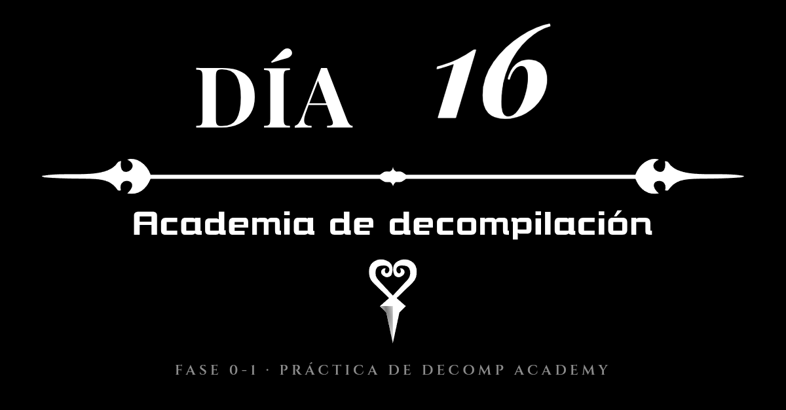
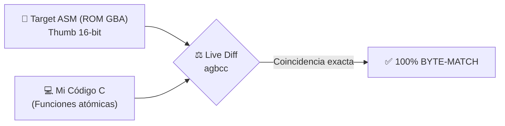
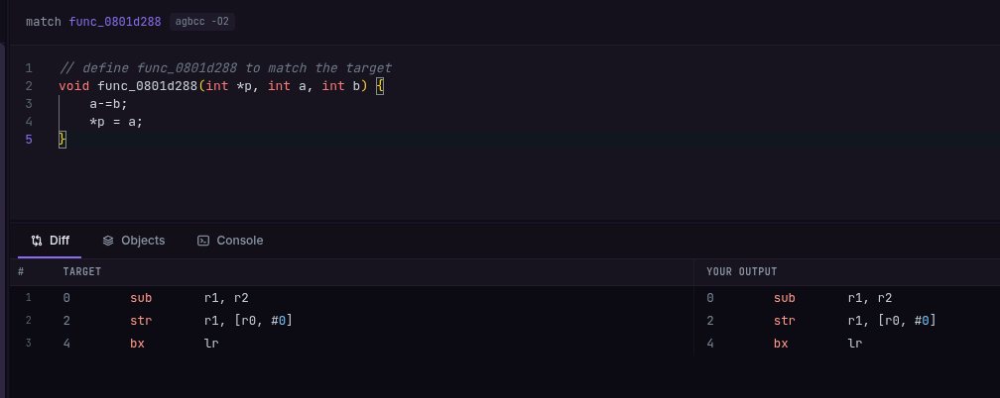

# Diario de aprendiendo a decompilar en 358/2 dias - Dia 16: (Academia de decompilación)

### Info:

- **Fecha**: 12 de Octubre de 2026
- **Objetivo general de la sesión**: Probar Decomp Academy tras la recomendación de Yokimitsuro y completar el bloque de calentamiento (*Warm Up*) de Game Boy Advance (ARM/Thumb).
- **Fase**: Fase 0 · Cimientos de C y Memoria de Bajo Nivel (Dojo de Matching Transversal)



---

## Nueva ruta a seguir: academia de decompilación

Ayer se creó el Discord para la ingeniería inversa de *Kingdom Hearts* de DS. Hablando con **Yokimitsuro**, el creador de la decompilación de *Kingdom Hearts 358/2 Days*, me enseñó una web llamada **[Decomp Academy](https://decomp-academy.dev/)**, creada por Jack Price-Burns (uno de los participantes en la decompilación de *Star Fox Adventures*), alguien de mucho renombre en la comunidad. En esta web podré aprender a decompilar usando software real, ya que según dice la web el código en assembly procede de proyectos reales. Ya no tendré que usar código ficticio creado por la IA, lo que para mí es un *win-win*.

Además, la plataforma está dividida en proyectos de GameCube, GBA y Nintendo 64 (PowerPC, ARM y MIPS: las tres grandes arquitecturas históricas de Nintendo). Sabiendo PowerPC puedo entender GameCube y Wii; con ARM tengo la base para GBA, DS, 3DS y Switch; y con MIPS, la Nintendo 64. Cada arquitectura tiene sus propias instrucciones en ensamblador (aunque me imagino que tendrán instrucciones e ideas en común). En total son unas 700 funciones que decompilar: va a ser duro, pero terminar las tres arquitecturas sería increíble.

Hoy he decompilado las 16 primeras funciones del plan de GBA; solo me quedan 239. En el peor de los casos pierdo la cordura, en el mejor de los casos pierdo la cordura y aprendo a decompilar.

Voy a hacerme un diccionario de las instrucciones de assembly que vaya aprendiendo y sus equivalencias en C; también formará parte de este reto.



---

## Bajo el capó: Mi primer 100% Match con punteros (`func_0801d288`)

Uno de los ejercicios más reveladores de hoy en el bloque de calentamiento ha sido decompilar una función que manipula punteros y operaciones aritméticas para que coincida byte a byte con el binario original usando el compilador histórico de GBA (`agbcc -O2`):



### El código en C que he escrito:

```c
// Compilador: agbcc -O2 (Modo GBA Thumb 16-bit)
// Definir func_0801d288 para matchear exactamente el target
void func_0801d288(int *p, int a, int b) {
    a -= b;
    *p = a;
}
```

### El ensamblador equivalente generado (Target ASM):

```arm
0:   sub   r1, r2         @ Resta: r1 = r1 - r2 (a -= b)
2:   str   r1, [r0, #0]   @ Almacena en memoria RAM: *p = a
4:   bx    lr             @ Retorno: vuelve al invocador
```

### ¿Qué hace la CPU aquí a bajo nivel?
En esta función el reto pide recibir tres parámetros: un puntero y dos enteros (`int *p, int a, int b`). Viendo el ensamblador se entiende a la perfección cómo interactúan la CPU y la memoria RAM física:

1. **Convenio de llamadas AAPCS en ARM**: La CPU de la GBA (ARM7TDMI) recibe los tres parámetros en los registros de propósito general: `r0 = p` (la dirección de memoria en RAM), `r1 = a` y `r2 = b`.
2. **Operación en registros (`sub r1, r2`)**: La resta `a -= b` se resuelve directamente en la ALU de la CPU en una sola instrucción (`sub r1, r2`).
3. **Escritura física a memoria RAM (`str r1, [r0, #0]`)**: La instrucción `str` (*store register*) toma el valor restado en `r1` y lo escribe directamente en la dirección física de memoria RAM guardada en el puntero `r0` (`*p = a`).
4. **Retorno (`bx lr`)**: Como trabajamos directamente desreferenciando el puntero en memoria, la función devuelve `void`. No devuelve nada por `r0`, simplemente salta a la dirección del llamador mediante el *Link Register* (`lr`).

¡El resultado es un **100% byte-match idéntico al código del juego comercial**!

---

## Conclusiones y Próximos Pasos

Siento que esto es justo lo que necesitaba: ahora puedo complementar mi formación de cimientos en C con lecciones prácticas de decompilación real. Estoy asustado y emocionado a partes iguales. Este enfoque me permitirá alternar el estudio de memoria en C con la ingeniería inversa práctica.

De momento he integrado este "Dojo de Matching" en la Fase 0 de mi roadmap como un puente transversal hacia la Fase 1 (mi "Fase 0-1"), porque empezar a tocar código real de consola desde ya cambia por completo las reglas del juego.

### Checklist:

- [x] Investigar Decomp Academy y su arquitectura de compiladores históricos.
- [x] Integrar Decomp Academy en la hoja de ruta (`docs/ROADMAP.md`) y contexto del proyecto.
- [x] Completar todas las 16 lecciones del bloque *Warm Up* de GBA en Decomp Academy.
- [x] Lograr múltiples 100% byte-matches en modo ARM/Thumb con `agbcc`.
- [x] Documentar la función `func_0801d288` (paso de parámetros en registros AAPCS y desreferenciación en RAM).

### Tags:

#DecompilandoEn358Dias #DecompAcademy #GBA #GameBoyAdvance #ARM #Thumb #BajoNivel #ReverseEngineering #MatchingDecompilation
