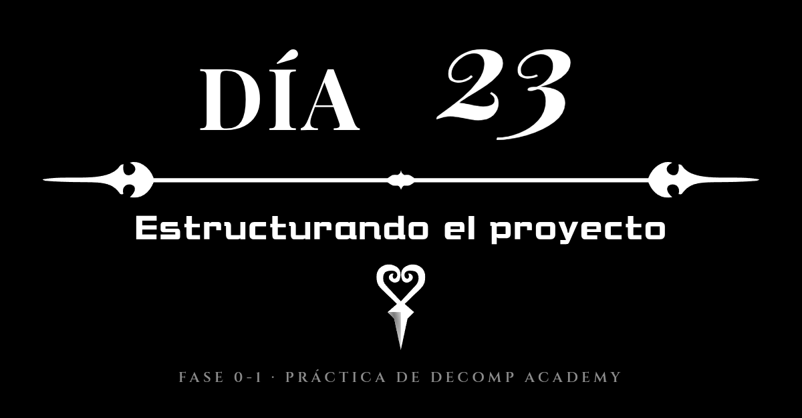
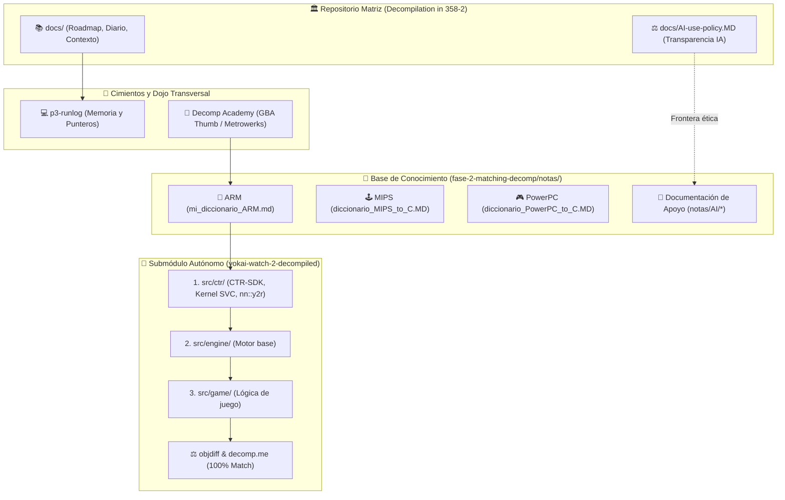

# Diario de aprendiendo a decompilar en 358/2 dias - Dia 23: (Estructurando el proyecto)

### Info:

- **Fecha**: 19 de Octubre de 2026
- **Objetivo general de la sesión**: Reorganizar el proyecto según el módulo que corresponda
- **Fase**: Fase 0-1 · Práctica de Decomp Academy



---

## Hitos en la decompilación de Yokai Watch 2

Caballeros, es de mi agrado informarles que por fin hemos llegado a la increible meta del 0.01% de Yokai Watch 2 Mentespectros decompilado 🎉🎉

Llevo el 0.25% de las funciones decompiladas (45 / 18225)

Y el 0.0108% del binario decompilado (676 / 6,238,892) bytes. O sea tendría que hacer 10000 veces lo que llevo, mas o menos, lo cual a un ritmo de 300 bytes por día mas o menos, lo que me tomaría 13 años (Sin contar el proceso de linkeado o revisión)... 

Y en principio no quiero tirarme con esto hasta los 36, por eso sé que tarde o temprano, si quiero convertir esto en algo plausible seguramente tenga que hacer la decompilación con IA para ir más rápido, pero estoy debatiendo éticamente cuándo es el momento adecuado para dar este paso, pero antes quiero dar un breve resumen:

El proyecto ahora está dividido por módulos:

```
include
├── common.h
├── ctr
│   ├── dsp.h
│   ├── ndm.h
│   ├── nex.h
│   ├── os.h
│   ├── svc.h
│   └── y2r.h
├── engine
│   ├── core.h
│   ├── lfw.h
│   └── lxp.h
├── game
│   ├── core.h
│   └── loops.h
└── types.h


src
├── ctr
│   ├── crt
│   │   └── clear_bss.s
│   ├── nn
│   │   ├── ndm
│   │   │   ├── func_00127EEC.c
│   │   │   └── func_001280A8.c
│   │   ├── nex
│   │   │   ├── func_00301248.c
│   │   │   ├── func_00340CE8.c
│   │   │   ├── func_00340CFC.c
│   │   │   ├── func_00340D08.c
│   │   │   ├── func_00340D18.c
│   │   │   └── func_00340D1C.c
│   │   ├── os
│   │   │   ├── func_00104D18.c
│   │   │   ├── func_001063F4.c
│   │   │   ├── func_0010678C.c
│   │   │   ├── func_001274A0.c
│   │   │   └── func_00127520.c
│   │   └── y2r
│   │       ├── func_00112D8C.c
│   │       ├── func_00112E60.c
│   │       ├── func_001137C0.c
│   │       ├── func_00113F58.c
│   │       └── func_00113F70.c
│   └── svc
│       ├── func_0013EC50.c
│       ├── func_0013EC5C.c
│       ├── svcBreak.c
│       ├── svcCloseHandle.c
│       ├── svcControlMemory.c
│       ├── svcCreateAddressArbiter.c
│       ├── svcCreateEvent.c
│       ├── svcCreateMemoryBlock.c
│       ├── svcCreateResourceLimit.c
│       ├── svcCreateThread.c
│       ├── svcCreateTimer.c
│       ├── svcDuplicateHandle.c
│       ├── svcExitProcess.c
│       ├── svcExitThread.c
│       ├── svcGetThreadId.c
│       ├── svcSleepThread.c
│       └── svcWaitSynchronization1.c
├── engine
│   ├── core
│   │   └── func_0013F29C.c
│   ├── gds
│   ├── lfw
│   │   ├── func_0010B6D0.c
│   │   └── func_0010B6D8.c
│   └── lxp
│       ├── func_0012CB00.c
│       ├── func_0012FEC0.c
│       ├── func_00130018.c
│       └── func_001300B0.c
└── game
    ├── core
    │   ├── func_00171C78.c
    │   └── func_0017656C.c
    └── loops
        ├── func_0010C894.c
        └── func_0011054C.c
```

Ahora las funciones se decompilan dentro del módulo que les corresponde:

1. **CTR-SDK: El SDK de Nintendo, las librerías de software de la 3DS.**
   - SVC: Las llamadas al kernel.
   - NN::OS: El subsistema de Nintendo.
   - NN::Y2R: Librería de conversión de YUV a RGB.
   - NN::NDM: Demonio de gestión de redes.
   - NN::NEX: El motor de red de Nintendo.
   - CTR/CRT: El arranque a bajo nivel.
2. **Engine: El motor de juego de Level-5, es decir las librerías del motor de juego.**
   - LFW: El framework de Level-5.
   - LXP: Librería crossplatform de Level-5.
   - CORE: El núcleo de servicios del motor.
3. **Game: El juego como tal, lo referente a la programación del juego.**
   - ywCLoopRPG: Exploración del mundo abierto (Mapas de Floridablanca / Vellón)
   - ywCLoopBattle: Sistema de combate.
   - ywCLoopMenu: Menús del Yokai Pad.
   - ywCLoopOgreTime: Minijuego de la pesadilla Oni (Gargantuo, Cazamentires, Demoniorco)
   - ywCLoopWatchmap: El uso del reloj en el mapa de navegación.
   - ywCLoopQR: El escáner de códigos QR.

Mi objetivo es decompilar y documentar cada uno de estos módulos con un objetivo claro, si yo no lo entiendo, no sirve, es decir no quiero soltar el código de Yokai Watch 2 y decir, ale, disfrutadlo, quiero asegurarme de que sea fácil trabajar con él aunque me lleve más esfuerzo.

Aunque para ello inevitablemente voy a tener que usar IA, este proyecto es inviable para una sola persona, pero no quiero hacerlo rápido y bien, quiero aprovechar esta oportunidad que se me está dando para hacer el mejor trabajo posible, al final esto va a ser parte de mi legado a esta comunidad y algo que seguirá online cuando yo muera, vale, me he venido un poco arriba.

Aunque aún no he decidido a partir de qué punto dejaré de hacer una decompilación manual a una asistida, me quería proponer alguna meta simbólica, viendo que llevo el 1% o el 5% del código decompilado, o a conseguir decompilar algún módulo en específico, por ejemplo el LFW o el NN::OS, aunque reconozco que me tienta ser capaz de comprender algo del juego como tal, pero para ello necesito decompilar el CTR y el Engine.

Deseadme suerte, estoy muy ilusionado por lo que puedo llegar a conseguir con esta ayuda, aunque me tire semanas, aunque sí que preferiría hacerlo algo más tranquilo y hacerlo sin estresarme mucho, ahora por ejemplo me consume demasiado tiempo, tal vez asistido por IA podría ir más rápido.

---

## El orden dentro del caos: separando mis notas y la IA

Cada vez que no entiendo una cosa normalmente le pido a Gemini que me haga una nota de eso, para mirarla más adelante, lo que llamo las Notas IA, lo hago para poder dejar un marcador para evitar interrumpir la sesión de decompilación tomando notas, luego en base a esas notas haré las mías, al final si puedo hacerme una primera "destilación" tendré más fácil hacer la mía.

---

## Mi diccionario personal de ARM y notas de arquitecturas

Adicionalmente a las notas estoy haciendo mi propio diccionario C / ARM Assembly, para poder estudiarlo, con el tiempo me he ido familiarizando con algunas instrucciones y lo que hacen, pero aún me quedo un poco corto, por ello me gustaría a lo largo del proyecto hacerme un diccionario para que pueda repasar el assembly de ARM, de cara a decompilar a futuro, además cuando haga una decompilación por IA, seguramente me toque revisar que todo es correcto y más importante, que lo entiendo.



---

## ¿Planes a futuro?

Sé que con un 0.01% de código decompilado es pronto para plantearse lo que sea, pero me entró la curiosidad y miré qué parte del binario coincide con los otros juegos de Yo-kai Watch de 3DS (excluyendo Busters y Sangokushi); creo que este proyecto se podría usar como base para decompilar otros juegos de la saga y mi descubrimiento fue mejor de lo que esperaba.

**Fantasqueletos y Carnánimas**

Tienen aproximadamente el 91,5% del código compartido con Mentespectros, es decir, para decompilar Fantasqueletos y Carnánimas solo tendría que decompilar el 8,5% restante.

Además, Fantasqueletos y Carnánimas comparten el binario al 99,999987%, ese 0,000013% es una única variable que decide cuál de los 2 juegos se ejecuta, lo que yo llamo montarse un Diamante Brillante / Perla Reluciente.

**Yo-kai Watch 1**

El clásico Yo-kai Watch que todos amamos comparte aproximadamente el 60% del código con Yo-kai Watch 2, siendo el 40% restante seguramente funciones sin optimizar o que se refactorizaron, más algunos elementos que se quitaron como cinemáticas y demás.

**Yo-kai Watch 3**

Yo-kai Watch 3 comparte aproximadamente el 50% de su código con Yo-kai Watch 2, por lo que tendría que decompilar la otra mitad (esperaba menos: Yo-kai Watch 3 es un juego enorme con mogollón de añadidos y un sistema de combate que cambia totalmente).

**_Esto solo son promesas_**, pero creo que este proyecto se podría convertir en una decompilación conjunta de las 3 versiones de Yo-kai Watch 2, aunque de momento solo me interesa decompilar las versiones europeas; podría decompilar las americanas, seguramente, mientras que en las japonesas ya lo dudo porque seguramente cambien muchísimas cosas.

Pero quiero ver qué puede salir de esto.

## Despedida

Uf... Han sido unos días productivos, creo que por hoy está bien, otro día más y mejor, hoy he avanzado mucho, espero seguir avanzando a este ritmo, deseadme suerte.

Adiosito.
---

### Checklist:

- [x] Redactar y publicar la declaración formal de transparencia en el uso de IA (`docs/AI-use-policy.MD` y `docs/politica-uso-IA.MD`).
- [x] Actualizar los `README.md` del repositorio principal y de la decompilación de Yo-kai Watch 2 reflejando la política de IA.
- [x] Iniciar `mi_diccionario_ARM.md` con equivalencias empíricas de ensamblador ARM a C.
- [x] Estructurar el árbol de notas separando el contenido propio del contenido de apoyo de IA (`notas/ARM/notas/AI/`).
- [x] Estandarizar cabeceras e includes en las funciones matcheadas del submódulo de Yo-kai Watch 2.

### Tags:

#DecompilandoEn358Dias #DecompAcademy #ARM #Thumb #ReverseEngineering #IAÉtica #Transparencia #BajoNivel

### 🤖 Transparencia en el uso de IA:
- **Redacción del diario**: 100% redactado por Carlos (reflexiones personales, cálculos y anécdotas).
- **Código y decompilación**: Funciones matcheadas y analizadas con apoyo de IA y objdiff según se detalla en la política de transparencia.
- **Soporte de la IA en esta entrada**: Generación de la plantilla inicial del día, diagrama Mermaid modular y consultas técnicas de arquitectura.

