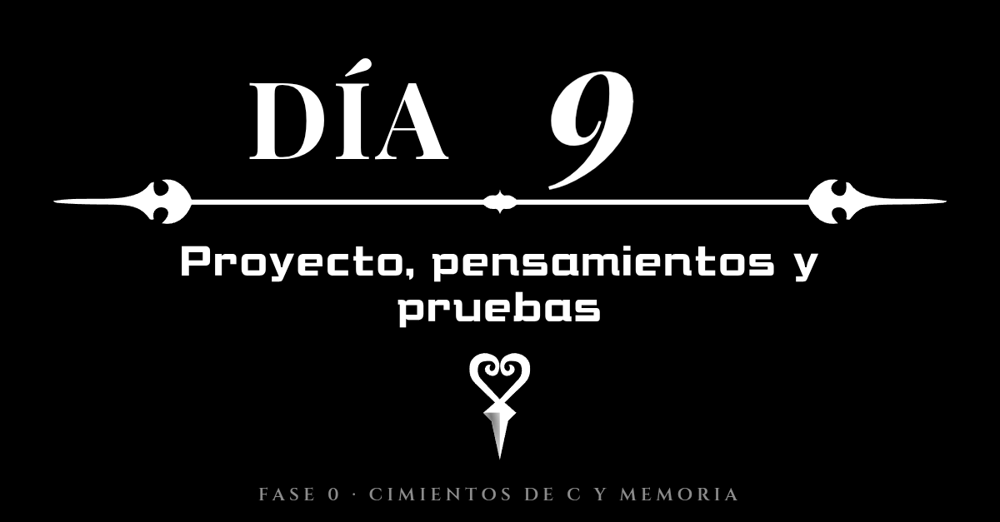
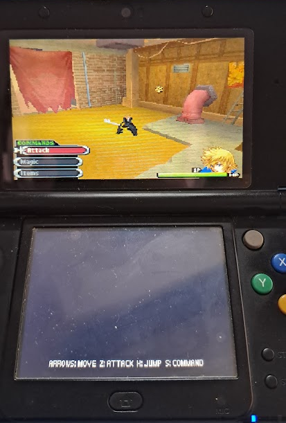

# Diario de aprendiendo a decompilar en 358/2 dias - Dia 9: (Proyecto, pensamientos y pruebas)

### Info:
- **Fecha**: 5 de Octubre de 2026
- **Objetivo general de la sesión**: Estructuración del proyecto Runlog con matrices y pruebas preliminares del port en 3DS.
- **Fase**: Fase 0 · Cimientos de C y Memoria de Bajo Nivel

***Este día no va a abarcar un solo día si no varios, pero intentaré contar las cosas en orden***

Esta va a ser la entrada mas extensa de mi diario hasta ahora y no es para menos, no he estado solo con el proyecto, he intentado diversificar un poco lo que hago, al final este proyecto no es solo aprender C, es decompilar, aunque poco he decompilado por ahora, pero he querido *experimentar*, pero todo a su debido momento.

## El proyecto

Esto no tiene mucho, habiendo aprendido arrays, punteros, funciones y control de flujo he creado un pequeño programa que podreis encontrar en: `fase-0-fundamentos-c/proyectos/p3-runlog`, es basicamente un conjunto de funciones que trabajan sobre una matriz, lectura, escritura y tal, donde los punteros han sido vitales porque estoy usando la variable para leer, toda la escritura la estoy haciendo sobre la RAM, es decir, nunca estoy ocupando matrices adicionales, solo creo "variables auxiliares" o crear un nuevo conjunto de datos, me parece un esfuerzo de optimización increíble, porque NUNCA he copiado nada que necesito para las operaciones, tengo que reconocer que me gusta, pero nunca dejaré de decir que es muy duro.

## Los pensamientos

Reconozco que entre el día 5 y el día 9 he sentido que ha cambiado mucho el panorama, en gran parte me siento intimidado porque no se si será demasiado para mi, me esta costando, nunca me cansaré de decirlo y tengo miedo que con los avances de IA mi esfuerzo se quede en nada, ojala que no, solo llevo 9 dias y siento que he aprendido mucho, pero me preocupa que el modelo de "cantidad antes que calidad" se imponga, literalmente cada día me levanto con 4-5 ports nuevos y con una comunidad completamente desatada, normal, cosas que antes llevaban meses hoy en dia se hacen en dias. Pero aún se nota mucho la diferencia entre un proyecto vibecodeado y uno completo.

Voy a intentar enfocarme en mi objetivo y en lo que quiero lograr, lo tendré que hacer mucho, al final lo sano es pensar en mis objetivos no en lo que es el panorama global.

## Las pruebas

Mi proyecto de aprendizaje esta "gestionado" por IA, soy docente, aunque aún no tenga el titulo, por ello este proyecto aunque los haga yo y estas entradas de las newsletter esten echas por mi, aunque luego las revisa una IA, me da miedo dejarme cosas mal escritas y me siento mejor con alguien que me diga que "todo OK", tambien la utilizo para el seguimiento, el plantear el temario y organizarlo todo, pero yo sigo haciendo las cosas, yo sigo el protagonista, no Gemini o Antigravity, además teneis las skills, el diario y el fichero AGENTS.MD y la carpeta .agents en el repositorio y seguramente pronto haga un comunicado sobre la ética del uso de la IA como he visto que tienen otros proyectos.

Mis pruebas con la IA han sido intentar hacer un port del port de Kingdom Hearts 358/2 days con resultados, cuestionables, mi objetivo es poder estudiar lo que hizo la IA para poder replicarlo a futuro, espero algún dia tener la capacidad de estudiar esto con el rigor que merece, entenderlo y ser capaz de retocarlo, pero eso cuando el port este completo, para eso es tambien este proyecto, va mas allá de decompilar es permitirme ser capaz de leer y modificar estas cosas.

Espero poder lograrlo.

## Despedida

Hasta ahora gestionaba esto con Gemini Plus, a partir de este dia lo gestiono con Gemini Pro, un salto gigantesco que me permite tener 6 veces mas capacidad de uso que antes y con la que espero lograr grandes cosas.

Aún con esto quiero alejarme lo maximo posible para alejarme de las cosas vibecodeadas, el AI Slop y demás, quiero demostrar mis capacidades.

Espero en algún momento ser digno de la llave necesaria para abrirme la puerta a hacer proyectos de decompilación.

Esa es mi promesa.

### Checklist:
- [x] Terminar el proyecto a falta de testearlo y estructurarlo mejor.
- [x] Conseguir que el port de Kingdom Hearts a 3DS tenga implementado todo lo que tiene la primera demo.

### Tags:
#DecompilandoEn358Dias #Nintendo3DS #KingdomHearts #IAÉtica #ArtesaníaDigital

