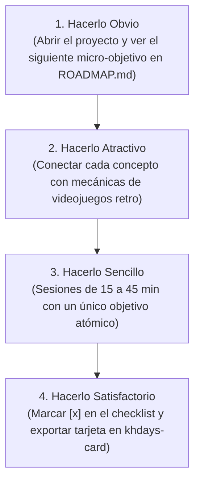
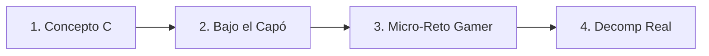

# Metodología de Estudio: Hábitos Atómicos y C de Bajo Nivel

Este documento define las reglas de juego y la metodología que seguiremos día a día en tu formación.

---

## 1. La Filosofía de Hábitos Atómicos aplicada al Código

El reto de **358/2 días** no se supera intentando hacer maratones esporádicos de 8 horas, sino mediante la regla del **1% mejor cada día**:

$$1.01^{365} \approx 37.78$$

Mejorar un 1% cada día te hace casi **38 veces mejor** al final de un año.

### Las 4 Leyes del Hábito en tu Día a Día



1. **Hacerlo Obvio**: Al sentarte al ordenador, no te preguntas "¿qué hago hoy?". Abres [`docs/ROADMAP.md`](ROADMAP.md) y tomas la siguiente casilla desmarcada.
2. **Hacerlo Atractivo**: Cada ejercicio de C no calcula nóminas ni inventarios bancarios; programa máquinas de estados de enemigos, sistemas de daño, gestión de ranuras de paneles o parsers de ROMs.
3. **Hacerlo Sencillo**: Reduce la fricción. La estructura de carpetas está limpia, el `Makefile` compila con un simple `make all`, y cada tarea se resuelve en 15–45 minutos.
4. **Hacerlo Satisfactorio**: Cuando una tarea funciona y no da warnings, marcas `[x]` y abres `tools/khdays-card/index.html` para generar tu tarjeta del día para compartir tu avance.

---

## 2. El Ciclo Pedagógico en 4 Pasos ("C Bajo el Capó")

En la programación tradicional, C se suele enseñar como un lenguaje algorítmico abstracto. Para **decompilar videojuegos**, C es en realidad **la forma humana de describir ensamblador y memoria física**.

Cada tema del temario sigue este ciclo estricto:



### Paso 1: Concepto C Directo al Grano
- Leemos la sintaxis esencial sin rodeos teóricos innecesarios.
- Ejemplos mínimos y directos que van a un único archivo `.c`.

### Paso 2: Bajo el Capó (Memoria y Ensamblador)
- ¿Qué hace realmente la CPU con esto?
- Inspeccionamos el código generado en ensamblador:
  ```bash
  gcc -S -O2 -fverbose-asm archivo.c -o archivo.s
  ```
  O lo abrimos en [Compiler Explorer (Godbolt)](https://godbolt.org/) con el compilador `ARM gcc 11.2 (none)`.
- Dibujamos mentalmente el stack frame: ¿dónde están los bytes? ¿hay padding? ¿es Little Endian?

### Paso 3: Micro-Reto Gamer
- Escribimos un programa corto que aplique el concepto a un videojuego:
  - Punteros: paso de daño por referencia y reducción de vida.
  - Structs con padding: formato de memoria de los 13 miembros de la Organización XIII.
  - Bits y flags: estados alterados (veneno, ceguera, prisa).
  - Punteros a función: tabla de despacho de comandos de batalla.

### Paso 4: Vistazo a Decompilación Real
- Abrimos el repositorio `khdays-decomp`, `khcom` o `zeldaret/mm`.
- Localizamos dónde los programadores originales usaron exactamente ese patrón en el juego comercial.
- Esto elimina la sensación de "estar aprendiendo teoría inútil": ves el impacto directo en el juego final.

---

## 3. Protocolo de Revisión y Code Review

Como tu tutor, **Antigravity** seguirá estas pautas en cada interacción:
1. **No dar la solución de golpe**: Si tienes un error de segmentación o un warning de compilador, te guiaré con preguntas socráticas e inspección de memoria para que tú descubras la causa raíz.
2. **Exigencia de Cero Warnings**: Todo código debe compilar con `-Wall -Wextra -Werror` antes de dar por buena una tarea.
3. **Validación de Hito**: Para pasar de bloque o fase, se realiza una pequeña prueba práctica de integración donde demuestras que dominas el concepto.
