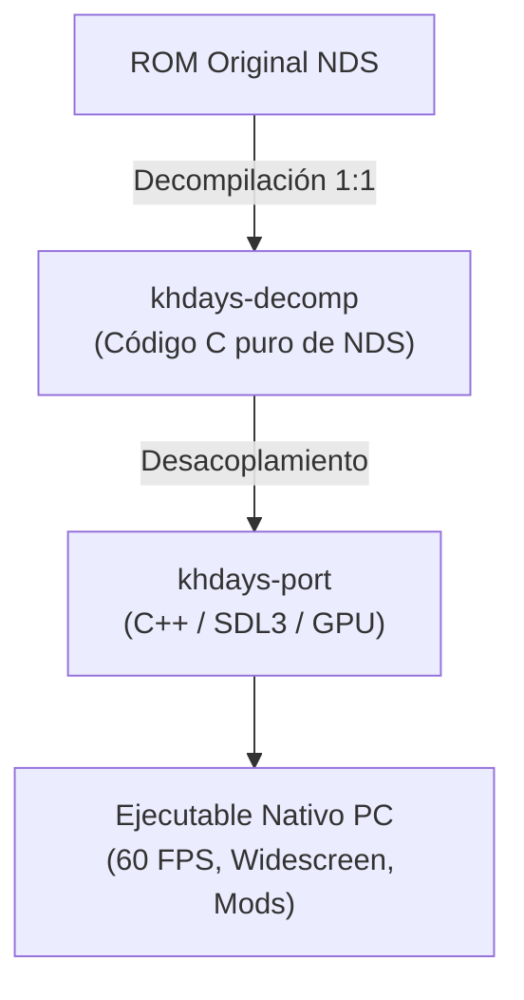

# Temario Detallado · Fase 4: Source Ports Nativos a PC (Kingdom Hearts 358/2 Days)

La **Fase 4** es la culminación de tu viaje. Aquí aplicarás todo lo aprendido: el conocimiento de C a bajo nivel, la comprensión de repositorios decomp y las habilidades de gráficos con SDL para entender, compilar y modificar el proyecto **`khdays-port`** (el source port nativo de *Kingdom Hearts 358/2 Days* mantenido por Yokimitsuro).

---

## Bloque 4.1: Anatomía de un Source Port Moderno

### Decompilación vs Port Nativo
- **`khdays-decomp`**: Reconstruye el código en C que compila idéntico a la ROM de Nintendo DS.
- **`khdays-port`**: Toma ese código decompilado y lo adapta a un runtime portátil para sistemas modernos (Linux, Windows, macOS).

### Capa de Abstracción de Hardware (HAL)
- En la Nintendo DS, el juego dibuja llamando a comandos de geometría y texturas de la GPU de Nintendo.
- En el port nativo, estas llamadas se interceptan y se traducen a primitivas de renderizado modernas (shaders OpenGL / Vulkan / SDL GPU), lo que permite:
  - Renderizado en alta resolución nativa sin límites de píxel.
  - Cámara orbital libre con ratón o segundo stick analógico.
  - Soporte para formatos de pantalla ancha (*Widescreen / Ultrawide*).

---

## Bloque 4.2: El Pipeline de Assets de Nintendo DS a PC

El juego original almacena sus recursos en formatos propietarios de Nintendo DS dentro del sistema de archivos del cartucho (**NitroFS**):
1. **Texturas (`TEX0`)**: Gráficos comprimidos y paletas de 16/256 colores → Decodificados a texturas estándar `RGBA8888`.
2. **Modelos 3D (`MDL0`)**: Mallas poligonales optimizadas para el hardware de 2004 → Convertidas a mallas compatibles con motores modernos.
3. **Animación Esquelética (`NSBCA`)**: Transformaciones de huesos calculadas por CPU en la DS → Procesadas con GPU Skinning en el port.
4. **Música y Efectos (`SDAT` / `SSEQ`)**: Bancos de sonido y secuencias MIDI propietarias → Reproducidas mediante un sintetizador de audio por software en tiempo real.

---

## Bloque 4.3: El Proyecto `khdays-port`

### Arquitectura de Módulos
- **`khdays::vfs` (Virtual File System)**:
  - Sistema de resolución de archivos de juego. Permite el sistema de **mods drop-in**: si colocas un archivo `.png` en la carpeta de mods con el mismo nombre que una textura original, el motor carga tu versión en alta resolución antes que la del cartucho.
- **`khdays::game`**:
  - Reproduce el esqueleto decompilado original: máquinas de estados, bucle de escena, inicialización de personajes (`BootTask_Construct`, transiciones de mundos).
- **In-Window Options con Dear ImGui**:
  - Menú nativo en pantalla para volumen, remapeo de botones, selección de pantallas (apiladas verticalmente o en paralelo) y pantalla completa.

---

## Bloque 4.4: Modding y Creación de Mejoras Propias

### Micro-Retos Finales
1. **Modificación de Assets (HD Mod)**:
   - Extraer una textura del menú o de la Keyblade de Roxas y sustituirla por una versión rediseñada en alta resolución.
2. **Modificación de Código de Juego**:
   - Localizar el archivo de control de Roxas en `khdays::game` y modificar parámetros de físicas (velocidad de carrera, altura de salto o retardo de combos).
3. **Extensión del Menú de Opciones**:
   - Agregar una nueva casilla o deslizador en el menú de Dear ImGui para activar una función de calidad de vida (ejemplo: invencibilidad para depuración o selector libre de mapas).

### Hito Final del Reto de 358/2 Días
Ejecutar tu versión personalizada de *Kingdom Hearts 358/2 Days* corriendo de forma nativa en tu ordenador a 60 FPS, tomar capturas/video, exportar tu tarjeta final en `tools/khdays-card` y compartir el logro de haber completado el reto formativo.
