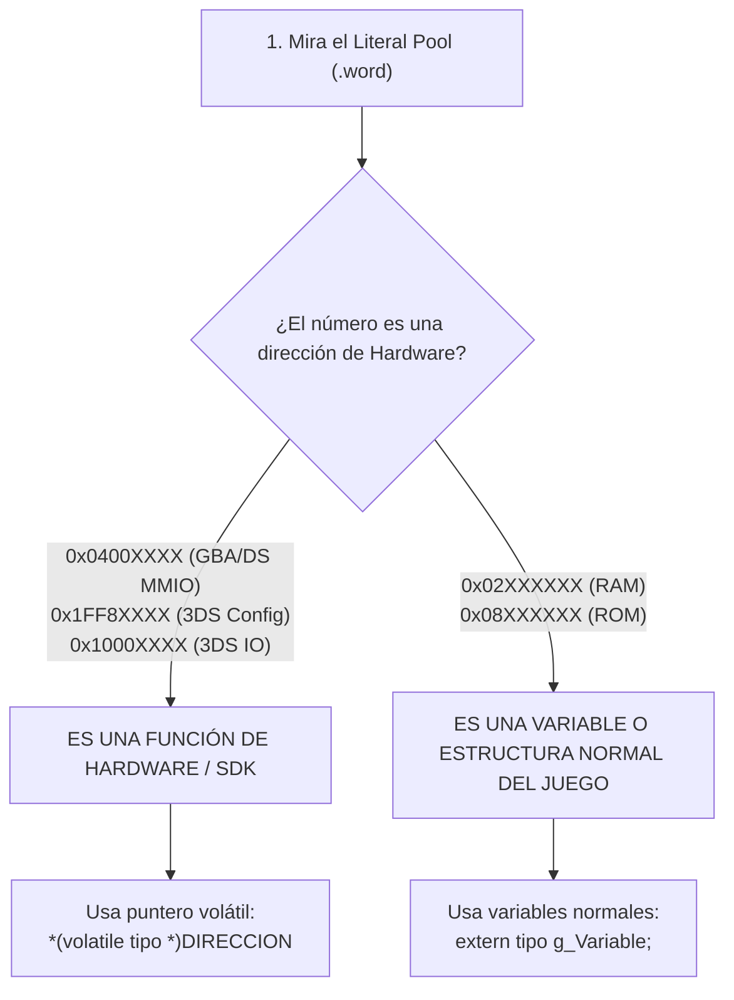

# Cuándo Usar `volatile` y Cómo Identificar Registros de Hardware

Guía práctica de bajo nivel sobre el uso correcto del calificador `volatile` en C, cómo interactuar con direcciones físicas de memoria y cómo reconocer funciones de hardware en decompilación.

---

## 1. El Propósito Profundo de `volatile`

En C estándar, los compiladores optimizan agresivamente los accesos a la memoria RAM:
- Si lees una variable dentro de un bucle y tu código C no la modifica, el compilador dice: *"Guardo este valor en un registro (`r4`) y no vuelvo a leer de la memoria jamás"*.
- Si escribes dos veces en la misma variable (`x = 1; x = 2;`), el compilador dice: *"La primera escritura sobra, solo escribo el 2"*.

Esto es ideal para variables normales, pero **catastrófico para hardware**:
1. Los registros de hardware (botones, timers, pantalla) **cambian solos** cuando el jugador pulsa un botón o pasa un ciclo de reloj.
2. Escribir en un registro de hardware desencadena **efectos físicos inmediatos** (encender un píxel, iniciar un DMA).

Al declarar un puntero como `volatile`:
> **Le prohíbes al compilador optimizar o cachear ese acceso.** Está legalmente obligado a emitir una instrucción física real (`ldr` o `str`) en ensamblador cada vez que toques esa memoria.

---

## 2. La Regla de Oro: ¿Cuándo SÍ y Cuándo NO?

### ✅ Cuándo SÍ se usa `volatile` (Hardware y Direcciones Fijas):
Se usa **cuando ves una dirección de memoria numérica fija (hardcodeada)** en el Literal Pool que corresponde a chips o registros del sistema:

```c
// Ejemplo 1: func_001063F4 en Yo-kai Watch 2 (Nintendo 3DS)
// Lee el registro SystemConfig en 0x1FF80040:
u32 func_001063F4(void) {
    return *(volatile u32 *)0x1FF80040;
}
```

```c
// Ejemplo 2: Lectura de botones del mando en GBA/DS (0x04000130):
#define REG_KEYINPUT (*(volatile u16 *)0x04000130)

u16 leer_mando(void) {
    return REG_KEYINPUT;  // Fuerza un ldrh físico cada vez que se llama
}
```

---

### ❌ Cuándo NO se usa `volatile` (El 95% del código del juego):
**Nunca se usa `volatile` en variables globales normales, structs del jugador o datos en RAM/ROM.**

Si pones `volatile` a una variable normal:
```c
// ¡ERROR TÍPICO EN DECOMPILACIÓN!
volatile int g_Puntuacion; // <-- NO HAGAS ESTO
```
- Forzarás lecturas y escrituras a la RAM innecesarias.
- El compilador no podrá guardar variables temporales en registros callee-saved (`r4`–`r11`).
- **Destruirás el 100% Match** produciendo un binario mucho más lento y largo que el original.

Para variables normales del juego, se declaran de forma limpia y estándar:
```c
extern int g_Puntuacion;  // El compilador ya sabe cuándo cargarla con ldr
```

---

## 3. Cómo Identificar Funciones de Hardware en Decompilación

Cuando abras una función anónima en Ghidra, IDA o decomp.me, sigue este patrón de reconocimiento:



---

### Mapa de Direcciones de Hardware en Consolas Nintendo

| Rango de Memoria | Consola | ¿Qué hardware representa? | Cómo decompilarlo |
| :--- | :--- | :--- | :--- |
| **`0x04000130`** | GBA / NDS | **Botones / Keypad**: Cruceta, A, B, Start, Select. | `*(volatile u16 *)0x04000130` |
| **`0x04000000`** | GBA / NDS | **Control de Pantalla (DISPCNT)**: Modos de vídeo. | `*(volatile u16 *)0x04000000` |
| **`0x040000B0`** | GBA / NDS | **Canales DMA**: Transferencias ultrarrápidas de RAM. | Puntero a struct `volatile DmaChannel *` |
| **`0x04000280`** | NDS | **Divisor y Raíz Cuadrada por Hardware** (NitroSDK). | `*(volatile u32 *)0x04000280` |
| **`0x1FF80000`** | 3DS | **System Configuration (CFG)**: Modelo de consola, memoria. | `*(volatile u32 *)(0x1FF80000 + offset)` |
| **`0x10140000`** | 3DS | **Controlador de Interrupciones (GIC / PICA)**. | Puntero volátil a registros del kernel. |

---

## 4. Resumen Mnemotécnico

1. **Dirección mágica de hardware en un `.word`**: $\rightarrow$ **`*(volatile u32 *)0xXXXXXXXX`**.
2. **Variable de la lógica del juego (vida, puntos, IA)**: $\rightarrow$ **Variable o puntero normal en C (sin `volatile`)**.

