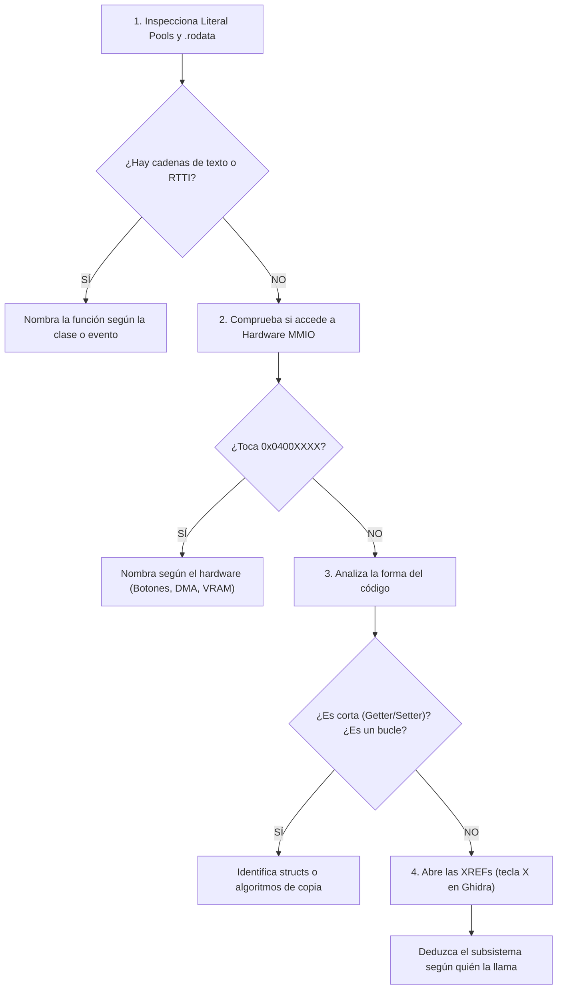

# Identificando Funciones y Patrones en Ensamblador ARM

Guía práctica de ingeniería inversa para descubrir qué hace una función desconocida (`func_0010XXXX`) a partir de sus huellas digitales en el binario.

---

## 1. El Dilema del Binario "Pelado" (Stripped)

Cuando extraemos el ejecutable de un cartucho comercial (ROM / `.code`), **todos los nombres de variables, funciones y estructuras han desaparecido**. Para el desensamblador, el código es solo una lista interminable de direcciones anónimas:

```text
func_00104D18
func_0010B6D0
func_0010B6D8
```

¿Cómo sabemos si una función calcula el daño de un ataque, mueve la cámara, reproduce un sonido o simplemente comprueba si has pulsado el botón **A**? 

Los desensambladores no leemos instrucción a instrucción a ciegas; buscamos **5 grandes huellas digitales** que delatan el propósito de cada función.

---

## 2. Huella 1: Cadenas de Texto, RTTI y Asertos (La "Mina de Oro")

Es la pista más rápida y certera. Casi cualquier binario comercial contiene cadenas de texto en su sección de solo lectura (`.rodata`).

### A. Clases C++ y RTTI (Run-Time Type Information)
Muchos motores de Nintendo DS y 3DS (como el Level-5 Framework de *Yo-kai Watch 2*) incluyen sistemas de tipos en tiempo de ejecución.
- Si ves una función pequeña que simplemente devuelve un puntero a `.rodata`:
  ```asm
  func_0010B6D8:
      ldr   r0, [pc]          @ Apunta a 0x008602F8
      bx    lr
      .word 0x008602F8        @ "lfwCLoopEmpty"
  ```
- **Deducción**: Es el método `GetClassName()` de la clase `CLoopEmpty`.
- **Nuevo nombre**: `CLoopEmpty_GetClassName`.

### B. Asertos de Depuración (*Assertions*)
A menudo los programadores olvidan compilar sin asertos, o los dejan en funciones críticas:
```text
"src/battle/damage.c:230: Assertion failed: target != NULL"
```
Una sola cadena como esta te da de golpe:
1. El archivo fuente original (`src/battle/damage.c`).
2. El número de línea original (`230`).
3. El nombre de la variable (`target`).
4. El propósito de la función: cálculo de daño en combate.

### C. Nombres de Assets y Eventos
Punteros a cadenas como `"btn_start"`, `"bg_title_press_any_key"`, `"snd_cursor_move"` o `"m01_boss_cutscene"` identifican al instante la escena o subsistema al que pertenece el código.

---

## 3. Huella 2: Registros de Hardware MMIO (La Huella Física)
> *"Dime a qué chip de la consola hablas y te diré quién eres."*

Las consolas de Nintendo interactúan con sus componentes físicos a través de direcciones de memoria fijas (*Memory-Mapped I/O*). Si una función lee o escribe en estas direcciones, sabes al 100% su propósito:

| Rango de Memoria | Componente Físico | Tipo de Función |
| :--- | :--- | :--- |
| **`0x04000130`** | `REG_KEYINPUT` (GBA/DS) | **Lectura de Mandos**: Comprueba si el jugador pulsa A, B, Cruceta, Start. |
| **`0x04000000`–`0x0400005F`** | Registros de Vídeo / PPU | **Gráficos 2D**: Configuración de pantallas, modos de vídeo, rotación y fondos. |
| **`0x040000B0`–`0x040000DF`** | Canales de DMA | **Transferencia Rápida**: Copia de texturas o bloques masivos de memoria sin gastar CPU. |
| **`0x04000060`–`0x040000A7`** | Canales de Sonido | **Motor de Audio**: Disparo de efectos de sonido, volumen o pistas musicales. |
| **`0x04000280`** | NitroSDK Math (DS) | **Matemáticas Hardware**: División o raíz cuadrada por hardware (`CP_SetDiv`). |

*Ejemplo*: Si una función lee `0x04000130` y hace un `bic` o `tst` con `0x0001`, está comprobando si el botón **A** está pulsado.

---

## 4. Huella 3: La Anatomía Estructural del Código

La forma de las instrucciones revela las construcciones típicas del lenguaje C:

### A. Getters y Setters de Estructuras (2 o 3 instrucciones)
- **Getter** (devuelve el campo de un objeto/struct):
  ```asm
  ldr   r0, [r0, #8]    @ Lee el offset +8 del struct que entra por r0
  bx    lr
  ```
  *En C*: `int get_campo(Objeto *this) { return this->campo; }`

- **Setter** (escribe en un campo de un objeto):
  ```asm
  str   r1, [r0, #8]    @ Guarda el valor r1 en el offset +8 de r0
  bx    lr
  ```
  *En C*: `void set_campo(Objeto *this, int valor) { this->campo = valor; }`

### B. Máquinas de Estados y Menús (`switch-case`)
Si observas una cascada de comparaciones o una tabla de saltos:
```asm
cmp   r0, #0
beq   EstadoReposo
cmp   r0, #1
beq   EstadoCaminar
cmp   r0, #2
beq   EstadoAtacar
```
Es la máquina de estados de la Inteligencia Artificial de una entidad o el selector de opciones de un menú.

### C. Copias y Limpiezas de Memoria (`memcpy` / `memset` caseros)
Si ves un bucle que decrementa un contador y utiliza instrucciones múltiples de carga y guardado (`ldmia` / `stmia`) o incrementa punteros (`*dest++ = *src++`), estás ante una función de copia de buffers o inicialización a ceros.

---

## 5. Huella 4: Convención C++ y el Puntero `this`

En Nintendo DS y 3DS, muchísimos juegos están escritos en C++. La convención de llamada estándar (AAPCS) tiene una regla de oro para métodos de clase:

> **El primer parámetro (`r0`) es SIEMPRE el puntero al objeto en sí (`this`).**

Si ves una función donde:
- `r0` nunca se sobrescribe al principio.
- Se lee constantemente memoria relativa a `r0`: `[r0, #4]`, `[r0, #8]`, `[r0, #16]`.
- Se llama a otras funciones pasando `r0` como primer argumento.

Estás ante un **método de clase en C++** operando sobre los miembros de su propia estructura:
```c
void Player_TakeDamage(Player *this, int damage) {
    this->hp -= damage;
    if (this->hp <= 0) {
        Player_Die(this);
    }
}
```

---

## 6. Huella 5: Las Referencias Cruzadas (XREFs en Ghidra / IDA)
> *"Dime quién te llama y te diré qué importancia tienes."*

Al pulsar la tecla **`X`** sobre una función en Ghidra, obtienes la lista de todas las partes del juego que llaman a esa función:

1. **Llamada desde 100 sitios diferentes**: Es una función de utilidad universal (librería matemática, `strlen`, `memcpy`, generador de números aleatorios `rand()`).
2. **Llamada dentro del bucle de espera de V-Blank**: Se ejecuta exactamente 1 vez por frame (60 veces por segundo). Es parte del **Bucle Principal del Juego** (*Main Game Loop*), actualizando física, entrada o render.
3. **Llamada solo una vez durante el arranque**: Código de inicialización de memoria, lectura de la cabecera del cartucho o carga de partidas guardadas (Save Data).

---

## 7. Protocolo del Detective: Paso a Paso para Renombrar una Función

Cuando te enfrentes a una función anónima `func_0010XXXX`:



Con este método transformarás un binario anónimo en código en C legible, estructurado y con sentido para el proyecto de decompilación.

